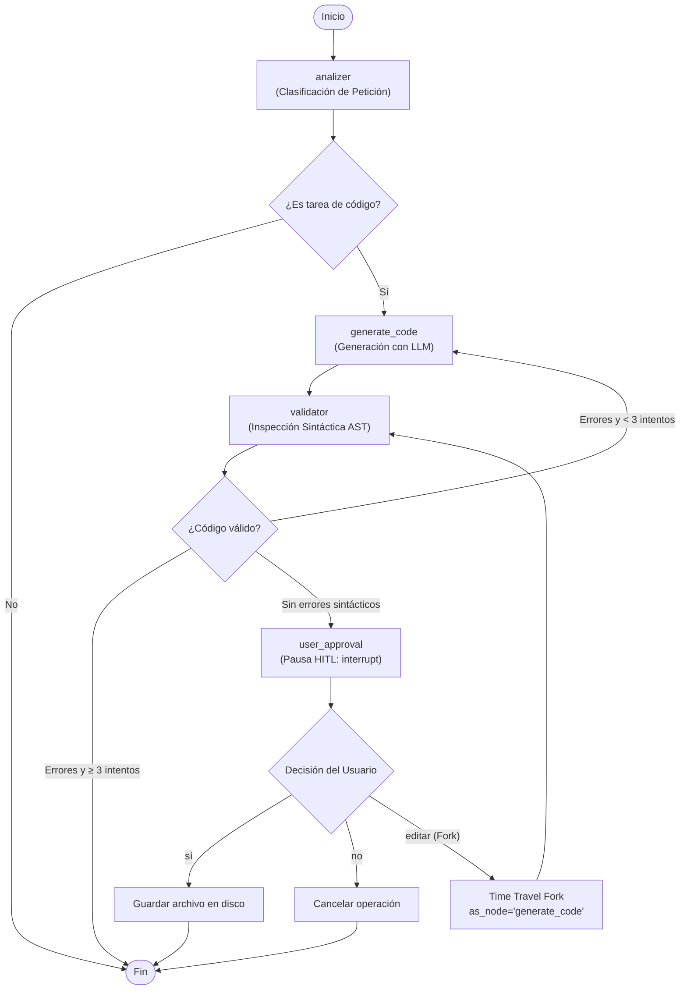

# 🛡️ Dev-Guard

> **Agente Cognitivo Autónomo para Generación y Validación de Código con Human-in-the-Loop y Time Travel en LangGraph.**

Dev-Guard es un asistente de ingeniería de software construido sobre **LangGraph** y **LangChain** que no solo genera código, sino que implementa un ciclo cerrado de autovalidación sintáctica (AST), control humano para operaciones sensibles (**Human-in-the-Loop**) y capacidades completas de **Time Travel (Replay & Forking)** para retroceder en el tiempo, inspeccionar checkpoints y editar código manualmente sin gastar tokens extra.

---

## ✨ Características Principales

* **🔌 Proveedor de LLM Agnóstico:** Soporte nativo y configurable para **Google Gemini**, **OpenAI**, **Groq** y **Ollama** vía variables de entorno.
* **📐 Salidas Estructuradas con Pydantic:** Análisis semántico de peticiones (`PetitionAnalisys`) y código tipado con explicaciones técnicas (`GeneratedCode`).
* **🔄 Ciclo de Autocorrección Determinista:** Validador sintáctico en tiempo real basado en el árbol de sintaxis abstracta (**AST**) de Python; si el código tiene errores sintácticos, el agente reintenta autónomamente (hasta 3 intentos) inyectando el feedback de los errores en el siguiente prompt.
* **⏸️ Human-in-the-Loop (HITL Moderno):** Pausa nativa en el nodo de guardado mediante `interrupt()` para solicitar confirmación explícita al usuario antes de escribir cambios en el disco.
* **🕰️ Time Travel (Replay & Forking):**
  * **Inspección de Checkpoints (`git log`):** Muestra el árbol inmutable de estados de cada sesión.
  * **Replay:** Reanuda la ejecución desde cualquier punto temporal del historial.
  * **Forking con `as_node`:** Permite al usuario editar el código en caliente e inyectarlo en el estado; el router lo envía directo al validador **sin volver a invocar el LLM**.
* **🎨 CLI Profesional con Rich:** Interfaz de terminal estética con tarjetas redondeadas, resaltado sintáctico de código (tema Monokai con números de línea), tablas de checkpoints con estados coloreados y spinners animados de carga.

---

## 🏗️ Arquitectura del Grafo

El flujo de trabajo está modelado como un grafo cíclico con puntos de control de memoria persistentes (`MemorySaver`):



---

## 📁 Estructura del Proyecto

```text
dev-guard/
├── main.py                   # CLI interactivo con Rich y comandos de Time Travel
├── time_travel_demo.py       # Demostración aislada del ciclo de Replay & Forking
├── requirements.txt          # Dependencias del proyecto
├── .env.example              # Plantilla de variables de entorno
├── src/
│   └── agent/
│       ├── graph.py          # Definición y compilación del StateGraph (LangGraph)
│       ├── nodes.py          # Nodos de negocio (analizer, generator, validator, HITL)
│       ├── state.py          # Modelos Pydantic y esquema del AgentState
│       ├── llm.py            # Factoría agnóstica de modelos de chat
│       ├── tools.py          # Herramientas del entorno y validadores AST
│       └── time_travel.py    # Utilidades para inspección, replay y forking
└── docs/
    ├── fase9-timetravel.md   # Especificación de Time Travel y analogía con Git
    └── hitl.md               # Especificación de Human-in-the-Loop con interrupt()
```

---

## 🚀 Instalación y Puesta en Marcha

### 1. Clonar el repositorio y configurar el entorno

```bash
git clone https://github.com/tu-usuario/dev-guard.git
cd dev-guard

# Crear entorno virtual
python3 -m venv .venv

# Activar entorno virtual
source .venv/bin/activate  # En Linux/macOS
# .venv\Scripts\activate   # En Windows
```

### 2. Instalar dependencias

```bash
pip install -r requirements.txt
```

### 3. Configurar variables de entorno

Copia la plantilla y configura tu proveedor de preferencia:

```bash
cp .env.example .env
```

Edita `.env`:

```env
# Proveedor soportado: "google", "openai", "groq"
LLM_PROVIDER="google"
LLM_MODEL="gemini-2.5-flash"
LLM_TEMPERATURE="0.0"

# Llave de API del proveedor seleccionado
GOOGLE_API_KEY="tu_clave_aqui"
```

---

## 💻 Uso

### Iniciar el CLI Interactivo

```bash
python main.py
```

### Comandos disponibles en la consola

| Comando | Descripción |
| :--- | :--- |
| `<petición de código>` | Procesa una solicitud (ej. *"Crea una función para calcular fibonacci"*). |
| `historial` | Muestra la tabla de checkpoints generados en la sesión actual. |
| `replay <indice>` | Viaja en el tiempo y reanuda el grafo desde el checkpoint indicado (ej. `replay 1`). |
| `reset` | Reinicia la memoria de la sesión y genera un nuevo `thread_id`. |
| `salir` / `exit` | Cierra la aplicación. |

---

## 🕰️ El Flujo de Time Travel en Acción

Cuando el agente genera código válido, se pausa en la pantalla de aprobación humana:

```text
╭───────────────────────────── 📝 CÓDIGO GENERADO ─────────────────────────────╮
│ 1 def calcular_iva(precio: float) -> float:                                  │
│ 2     """Calcula el 21% de IVA sobre un precio dado"""                       │
│ 3     return precio * 0.21                                                   │
╰──────────────────────────────────────────────────────────────────────────────╯
```

Tienes 3 caminos:
1. **`sí`**: Guarda el código en disco con el nombre que elijas.
2. **`no`**: Cancela la operación sin escribir archivos.
3. **`editar` (Time Travel Fork)**:
   * Te permite escribir o pegar tu propia versión del código en la terminal.
   * El sistema bifurca el estado (`fork_state`) con `as_node="generate_code"`.
   * El grafo se reanuda saltando directamente al validador sintáctico, **sin llamar nuevamente a la API de OpenAI/Google**, ahorrando tiempo y tokens.

### Probar la Demo Guiada de Time Travel

Para comprobar de forma automatizada cómo se crean y persisten las ramas temporales:

```bash
python time_travel_demo.py
```

---

## 🛠️ Tecnologías Utilizadas

* **Orquestación Cognitiva:** [LangGraph](https://github.com/langchain-ai/langgraph) (StateGraph, Checkpointing, Interrupts)
* **Framework LLM:** [LangChain Core](https://github.com/langchain-ai/langchain)
* **Validación de Datos:** [Pydantic v2](https://docs.pydantic.dev/)
* **Interfaz de Consola:** [Rich](https://github.com/Textualize/rich)
* **Testing:** [Pytest](https://docs.pytest.org/)

---

## 📄 Licencia

Este proyecto está distribuido bajo la licencia MIT. Consulta el archivo `LICENSE` para más información.
